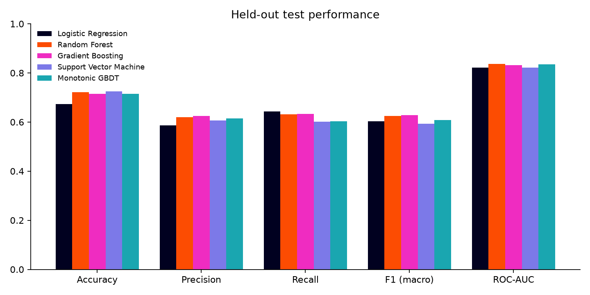
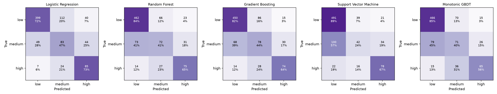
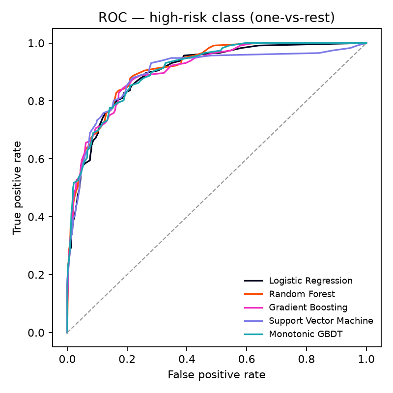
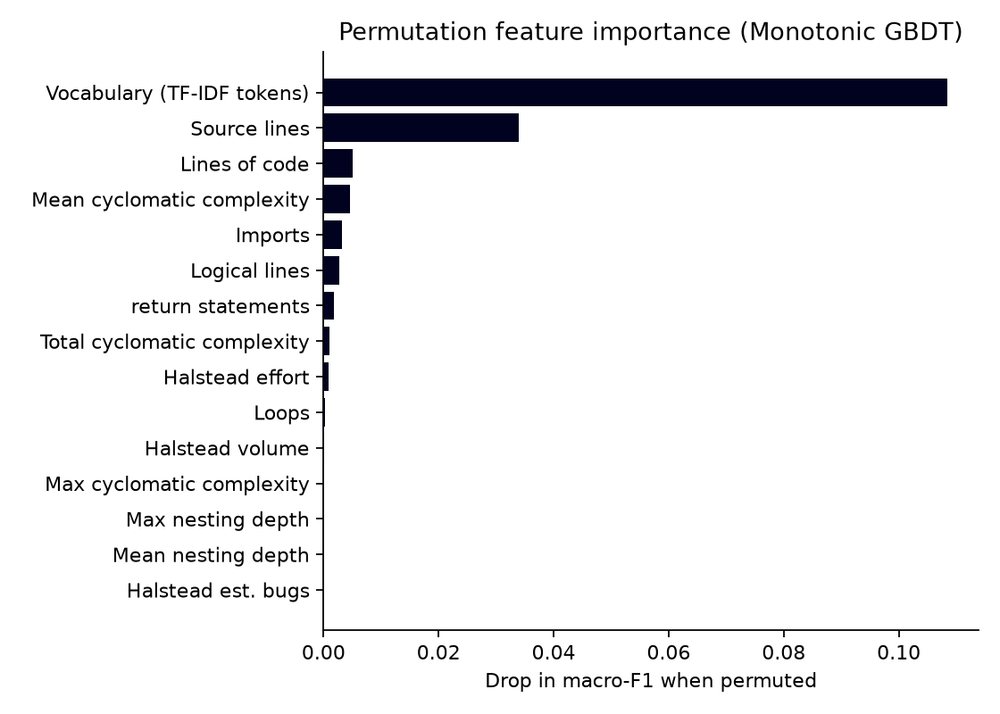

# CodePulse: model evaluation report

**Task:** predict the *future defect risk* of a Python source file from static features alone.
Each file goes into one of three classes: **Low** (no bug-fix commits), **Medium** (1–2) or **High** (3+).

All numbers below are regenerated by `python -m ml.train` and served live by `GET /api/v1/metrics`.

## 1. Dataset

| Property | Value |
|---|---|
| Source | 14 open-source Python repositories (their full git history) |
| Snapshot | last first-parent commit before **2024-01-01** in each repo |
| Label window | commits from the snapshot to **2026-01-01** (2 years) |
| Files | **4,213** non-test `.py` files with ≥ 10 source lines |
| Class balance | Low 2,754 (65 %) · Medium 879 (21 %) · High 580 (14 %) |
| Split | 80 / 20 stratified train/test (3,370 / 843), `random_state=42` |

| Repo | Files | Repo | Files |
|---|---|---|---|
| home-assistant/core | 1,294 (sampled from all) | scrapy | 151 |
| sympy | 746 | matplotlib | 148 |
| django | 605 | celery | 143 |
| fastapi | 443 | pytest | 68 |
| pandas | 269 | black | 39 |
| scikit-learn | 245 | flask / httpx / requests | 23 / 22 / 17 |

**Labelling.** A commit is a *bug-fix commit* if its subject matches
`fix|fixes|fixed|fixing|bug|bugfix|hotfix|regression|crash|defect|fault|broken|incorrect|wrong`
(this also matches Django's `Fixed #NNNN` convention). Each snapshot file's label is the number of such commits that
touched it inside the window. **Features are measured on the snapshot and labels come strictly from later
commits**, so the target cannot leak into the features. This mirrors the PROMISE / NASA-MDP defect-prediction setup,
but on Python and with labels mined directly from history.

Excluded: test suites, docs, examples, benchmarks, migrations, `setup.py` / `conftest.py` / `conf.py`, files
> 400 KB, and files that do not parse under Python 3.12. Repos with more than 1,500 eligible files are randomly
sampled down to 1,500 so that no single project dominates.

## 2. Features

**Structural (28, tabular)**, extracted with `radon` and `ast` (`backend/ml/features.py`):
size (LOC, SLOC, LLOC, blanks), documentation (comment lines, comment-to-code ratio), structure (functions,
classes, imports, mean/max parameters), complexity (total/mean/max cyclomatic complexity, number of functions
with CC > 10, max/mean nesting depth, with `elif` correctly *not* counted as nesting), control flow (branches,
loops, `try` blocks, returns), Halstead (volume, difficulty, effort, estimated bugs), and the Maintainability Index.
All are `log1p`-transformed and standardised.

**Text (NLP):** a token document per file made of identifier sub-words (`parseHttpResponse` →
`parse http response`), keywords (`kw_if`, `kw_try`, …) and words from comments and docstrings. This is fed to
TF-IDF (5,000 terms, `min_df=5`, sublinear TF) and then reduced to 100 latent dimensions with TruncatedSVD
(latent semantic analysis).

Every model sees the identical 128-dimensional input, so differences in the results come from the learner alone.

## 3. Models and tuning

All five models are scikit-learn `Pipeline`s, tuned with `GridSearchCV` on the training split
(stratified 5-fold CV, scoring = macro-F1) and then refit on the full training split.

| Model | Grid | Selected |
|---|---|---|
| Logistic Regression (multinomial, L2, balanced) | C ∈ {0.01, 0.1, 1, 10} | C = 0.01 |
| Random Forest (400 trees, balanced-subsample) | max_depth ∈ {12, None}, min_samples_leaf ∈ {1, 4} | depth 12, leaf 4 |
| Gradient Boosting (`HistGradientBoostingClassifier`, 300 iters, balanced) | lr ∈ {0.03, 0.1}, max_leaf_nodes ∈ {15, 31} | lr 0.03, 15 leaves |
| SVM (RBF, balanced, sigmoid-calibrated) | C ∈ {1, 10}, γ ∈ {scale, 0.003} | C = 1, γ = scale |
| **Monotonic GBDT** (ordinal, constrained; see §3.1) | lr ∈ {0.05, 0.1}, max_leaf_nodes ∈ {15, 31} | lr 0.05, 31 leaves |

*Implementation note:* the gradient-boosting model is scikit-learn's histogram GBDT, which uses the same algorithm as
LightGBM. We chose it over XGBoost/LightGBM because those need an OpenMP runtime (`libomp`) installed separately on
macOS; this choice keeps the project to a single `pip install`.

### 3.1 The fifth model: Monotonic GBDT (default for analysis)

The first version of the app served the unconstrained Gradient Boosting model, which had the best test F1. Its
explanations were sometimes indefensible. On a tangled 119-line file it reported that *"max cyclomatic complexity
45 lowers the risk score"*: the trees had overfitted a sparse corner of feature space where small files with one
huge function happened to receive few fixes.

The fix is to encode a domain prior: **more size, complexity, nesting, branching or Halstead effort must never
lower the predicted risk, and a higher Maintainability Index must never raise it**. Comment metrics and the
vocabulary dimensions are left unconstrained. scikit-learn supports monotonic constraints only for binary targets,
so the model uses the ordinal decomposition of Frank & Hall (2001):

* two binary `HistGradientBoostingClassifier`s, trained with `monotonic_cst`, estimate
  p₁ = P(risk > low) and p₂ = P(risk > medium);
* class probabilities are P(low) = 1 − p₁, P(medium) = p₁ − p₂, P(high) = p₂, with p₂ clipped to ≤ p₁.

This also uses the fact that the classes are *ordered*, which the four nominal classifiers ignore. The constraint
costs essentially nothing: the Monotonic GBDT has the **highest 5-fold CV macro-F1 of all five models**
(0.603 ± 0.023). Its held-out F1 (0.609) is 0.019 below unconstrained boosting, well inside one CV standard
deviation. It is therefore the default model for `/analyze`, and the test suite checks the monotonicity
property (`test_default_model_is_monotonic_in_complexity`).

## 4. Results (held-out test set, n = 843)

| Model | Accuracy | Precision | Recall | F1 (macro) | ROC-AUC | CV F1 (5-fold) | Cross-repo F1 | Latency (ms/file) | Train time (s) |
|---|---|---|---|---|---|---|---|---|---|
| Logistic Regression | 0.673 | 0.586 | **0.643** | 0.603 | 0.822 | 0.580 ± 0.015 | 0.532 ± 0.066 | **4.3** | **15** |
| Random Forest | 0.722 | 0.620 | 0.631 | 0.625 | **0.836** | 0.590 ± 0.019 | **0.535 ± 0.047** | 31.4 | 33 |
| **Gradient Boosting** | 0.714 | **0.625** | 0.633 | **0.628** | 0.832 | 0.595 ± 0.022 | 0.518 ± 0.042 | 38.6 | 82 |
| Support Vector Machine | **0.725** | 0.607 | 0.601 | 0.593 | 0.822 | 0.577 ± 0.009 | 0.451 ± 0.020 | 4.9 | 37 |
| Monotonic GBDT *(default)* | 0.714 | 0.615 | 0.603 | 0.609 | 0.835 | **0.603 ± 0.023** | 0.524 ± 0.051 | 29.8 | 92 |

Precision, recall and F1 are macro averages over the three classes. ROC-AUC is one-vs-rest, macro-averaged.
Latency is a single-file `predict_proba` call, measured during training. The live `/analyze` request takes ≈ 300 ms in total because it also extracts features, runs all five models and computes the attributions. For reference, a majority-class baseline scores 0.654 accuracy but only
**0.264 macro-F1**.

### Confusion matrices

### ROC: high-risk class

### Permutation feature importance (Monotonic GBDT, the served model)

The largest single drop in macro-F1 comes from permuting the **vocabulary** block (≈ 0.11). Size comes next
(SLOC ≈ 0.03), followed by LOC, mean cyclomatic complexity, imports and logical lines. (In the unconstrained
Gradient Boosting model the order was the same, with SLOC ≈ 0.08.) Permutation importance understates correlated features: SLOC, LLOC, CC-total and Halstead volume are
strongly inter-correlated (Spearman ρ > 0.8), so each one looks less important on its own than the group is together.

## 5. Discussion

* **Gradient Boosting has the best held-out macro-F1, and Monotonic GBDT the best CV macro-F1.** The tree models sit
  within 0.035 F1 of each other, and the cross-validation standard deviations (≈ 0.02) are of the same order, so
  they are not meaningfully separable on this data. We serve the monotonic model for its explanations (§3.1).
* **The medium class is the hard one** (per-class F1 ≈ 0.42 for all models). One or two fix commits in two years is a
  noisy signal, and those files sit between the two extremes. Low and High are separated well (F1 ≈ 0.83 and ≈ 0.63).
* **SVM wins on accuracy but loses on macro-F1.** It pushes medium files into the majority Low class (recall
  0.24 on medium). This shows why accuracy is misleading on an imbalanced target.
* **Logistic Regression has the best recall**, catching 73 % of the high-risk files. That makes it the right choice when
  missing a risky file costs more than reviewing a safe one, and it is also the fastest model.
* **Cross-project generalisation.** When whole repositories are held out (GroupKFold), macro-F1 falls by
  ≈ 0.07–0.14. Part of what the models learn is project-specific: vocabulary and bug-fixing culture
  differ between projects. The size and complexity signal does transfer, and Random Forest transfers best.

## 6. Explanations in the app

The risk score is `100 × (0.5·P(medium) + P(high))`. "Top risk factors" are computed by **baseline substitution**:
each structural feature is replaced in turn by its training-set median (the vocabulary block by an empty
document), and the resulting change in risk score is that feature's contribution. All 29 perturbations are scored in
one batched call. This works with any of the five models and needs no extra dependency such as SHAP.

## 7. Limitations

* The keyword heuristic for labelling has known noise: some "fix" commits fix typos or docs, and some real bug fixes
  don't say "fix".
* Renames are not followed inside the label window (rename detection on a blobless clone would download every
  changed blob), so a file renamed after the snapshot loses its later fixes.
* Commit frequency, i.e. how actively a file is developed, is a confounder: busier files get more fixes. That
  information is a *process* metric and can't be computed from a single pasted file, so it is deliberately not a
  feature. It is stored as `total_commits` in the dataset for analysis.
* **Risk grows with file size.** The label counts fixes to the *whole file*, so a short but tangled snippet can
  correctly score Low: it simply has less code to break. The per-function flags in the UI capture local
  complexity independently of the model.
* Python only, and file-level only. Per-function metrics are shown in the UI as diagnostics against fixed thresholds;
  they are not predicted.
